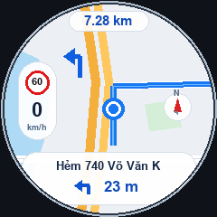

# RoadLink — Đồng hồ dẫn đường xe máy ESP32

Đồng hồ dẫn đường xe máy thông minh: App điện thoại kết nối **BLE** gửi dữ liệu chỉ đường sang **ESP32**, hiển thị bản đồ vector offline và cảnh báo tốc độ trên màn hình tròn 240×240.



---

## 1. Thiết bị cần có (Chọn theo nhu cầu)

### 🌟 Phương án 1: MÀN HÌNH TRÒN KHÔNG CẦN THẺ NHỚ *(Khuyên dùng)*
> Cực gọn, tiết kiệm chi phí. App điện thoại tự động truyền toàn bộ lộ trình, mũi tên rẽ, khoảng cách, tốc độ và biển báo qua Bluetooth BLE (giống Apple Watch / Garmin).

* **ESP32-S3 DevKit** (N8R8) + **Màn hình tròn GC9A01** 1.28" IPS 240×240.
* *(Hoặc mua Board tích hợp: **Waveshare ESP32-S3-LCD-1.28** cắm Type-C là chạy).*
* **Nối dây màn hình với ESP32-S3:**
  * `SCLK` $\to$ GPIO 12, `MOSI` $\to$ GPIO 11, `DC` $\to$ GPIO 9, `CS` $\to$ GPIO 10, `RST` $\to$ GPIO 8, `BL` $\to$ GPIO 7, `VCC/GND` $\to$ 3.3V/GND.
  * **HOÀN TOÀN KHÔNG CẦN MODULE HOẶC THẺ NHỚ MICROSD!**


---

### 💰 Phương án 2: SIÊU RẺ — OLED Đơn sắc (< 100.000 VNĐ)
> Không cần màn màu, không cần thẻ nhớ. Hiển thị thông số dạng đồng hồ xe máy điện tử.

* **ESP32 thường** (hoặc ESP32-C3 SuperMini): ~45.000 đ
* **Màn hình OLED 0.96" SSD1306 (I2C trắng đen)**: ~30.000 đ
* **Nối đúng 4 dây:** VCC $\to$ 3.3V, GND $\to$ GND, SDA $\to$ GPIO 21, SCL $\to$ GPIO 22.


---

### 🗺️ Phương án 3: Bản đồ Offline diện rộng từ thẻ MicroSD
> Dành cho ai muốn vẽ cả mạng lưới đường phố ngõ hẻm offline khi không kết nối mạng.

* Cần thêm thẻ MicroSD (FAT32) chứa 1.259 file bản đồ `.rlm` (~5.7 MB). Nối chân SPI thẻ SD: SCLK: 39, MOSI: 40, MISO: 41, CS: 42.

---

## 2. Lệnh vận hành nhanh

### 📱 Chạy App điện thoại
```bash
npm ci && npm run dev          # Chạy web thử nghiệm (http://localhost:5173)
npm run ios:sync               # Build bản native iPhone
```

### ⚡ Nạp Firmware ESP32
```bash
pio run -d firmware -e esp32-s3-round-nosd -t upload   # Màn tròn KHÔNG CẦN THẺ NHỚ (Cách 2)
pio run -d firmware -e esp32-oled -t upload            # Bản OLED đơn sắc giá rẻ (< 100k)
pio run -d firmware -e esp32-s3-round -t upload        # Bản có thẻ nhớ bản đồ offline
pio device monitor -d firmware                         # Xem log BLE & tọa độ
```

### 🤖 AI Quét biển báo Street View (Không check đèn đỏ)
```bash
node scripts/crawl-all-hanoi.mjs                  # Quét Street View Hà Nội
python3 scripts/detect_from_captured.py           # AI trích xuất biển báo tốc độ/biển cấm
```

---

## 3. Tài liệu kỹ thuật
- [docs/TFT_DISPLAY.md](docs/TFT_DISPLAY.md): Cấu hình màn hình & chân SPI.
- [docs/BLE_PROTOCOL.md](docs/BLE_PROTOCOL.md): Giao thức gói tin Bluetooth LE.
- [docs/ROAD_DATA.md](docs/ROAD_DATA.md): Định dạng dữ liệu bản đồ OpenStreetMap.

