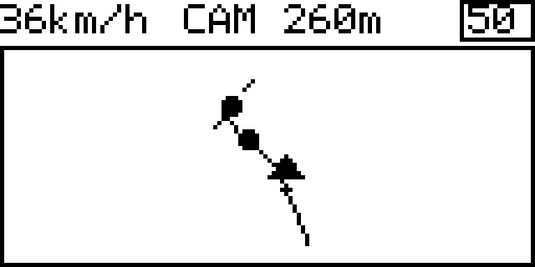
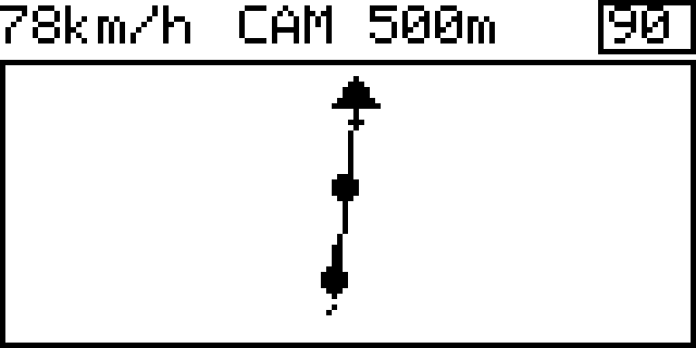
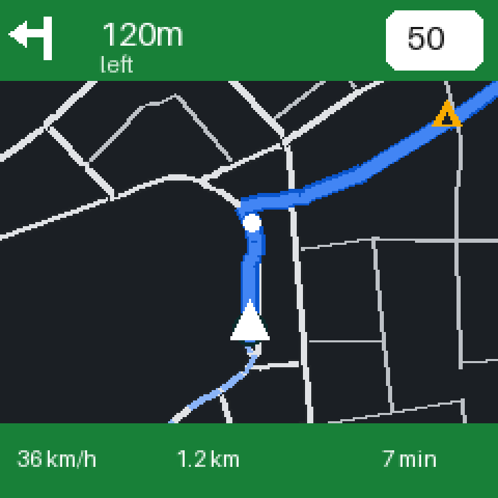
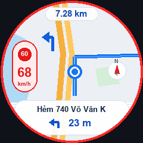

# RoadLink

App tìm đường cho iPhone, dùng độc lập hoặc gửi chỉ dẫn đến ESP32 qua **Bluetooth Low Energy**. Không cần bật hotspot. Giao diện tiếng Việt, có bản chạy trình duyệt để phát triển và kiểm thử. Luồng chính: tìm địa điểm → thẻ địa điểm → Chỉ đường → chọn tuyến → bắt đầu.

## Chạy ngay trên máy hiện tại

Yêu cầu Node.js 22.12+ hoặc 24+.

```powershell
cd C:\Users\zilong\RoadLink
npm ci
npm run dev
```

Mở `http://localhost:5173`, tìm hoặc ghim điểm đến, bấm **Chỉ đường**, chọn điểm đi hoặc dùng vị trí thiết bị rồi chọn **Bắt đầu dẫn đường**. Không có GPS vẫn chọn được điểm đi thủ công để xem tuyến; không âm thầm dùng vị trí có sẵn. Không tạo camera/biển mẫu, không thay API/GPS/BLE/voice bằng mock.

Theo yêu cầu ngày 22/11/2026, có chế độ **chỉ mô phỏng xe di chuyển**: chọn **Mô phỏng từ Ngõ 37 Bằng Liệt** → đợi tải tuyến và dữ liệu đường → **Mô phỏng di chuyển trên tuyến này**. Tuyến OSRM hiện trả về dài khoảng 11,2 km tới khu vực Hồ Hoàn Kiếm, đi qua điểm STOP đã có trong OSM. Có tạm dừng/tiếp tục và tốc độ phát ×1/×3/×8; xe màu cam phân biệt với GPS thật. Biển/điểm cảnh báo đọc từ cùng gói OSM, không được tạo thêm để phục vụ mô phỏng. Vị trí phát lại không thay API định vị và không gửi sang ESP32; app gửi lệnh dừng hiển thị cũ rồi chặn gói tuyến/nav trong chế độ này.

Để dùng vị trí thật trên web: truy cập localhost hoặc HTTPS và cấp quyền định vị. Nếu mở từ điện thoại qua IP LAN bằng HTTP, trình duyệt có thể chặn GPS/BLE vì không phải secure context. Với iPhone, nên chạy bản Capacitor native bên dưới.

## Tính năng đã có trong code

- Bản đồ OpenStreetMap, kéo/zoom, định vị và căn lại bản đồ.
- Ghim điểm bằng cách chạm bản đồ; thẻ địa điểm có Chỉ đường, Lưu và Chia sẻ.
- Sửa điểm đi/điểm đến, lấy vị trí của bạn, đảo hai điểm và chọn tuyến thay thế nếu OSRM trả về; không tự tạo tuyến giả.
- Tìm địa điểm Việt Nam hoặc nhập trực tiếp vĩ độ, kinh độ; chỉ hiện địa điểm do người dùng thực sự lưu, không tạo sẵn gợi ý tại TP.HCM.
- Tính tuyến **ô tô**, xem chiều dài, thời gian ước tính và từng hướng rẽ.
- Dẫn đường từ GPS thật: lọc fix kém chính xác, giảm rung tiến độ, không nhảy qua nhánh đường ở giao cắt, báo khi GPS cũ.
- Chọn **đích danh giọng Việt** cho cả trình duyệt và native. Nếu không có giọng Việt, hiện hướng dẫn cài giọng và giữ chỉ dẫn trên màn hình; không dùng giọng Anh thay thế. Trên trình duyệt cần một giọng `vi`/`vi-VN` thực sự có sẵn trong hệ thống/trình duyệt.
- Xác nhận 3 fix lệch tuyến trước khi tính lại; giữ tuyến cũ nếu mạng lỗi.
- Kết thúc hành trình, báo đến nơi; cố gắng giữ màn hình sáng khi đang dẫn.
- BLE tùy chọn: chọn ESP32, gửi tuyến, hướng rẽ, khoảng cách và tốc độ; mất BLE không dừng dẫn đường.
- Giao diện responsive, trạng thái lỗi mạng/quyền vị trí rõ ràng; GPS có mũi tên hướng di chuyển và trạng thái chưa xác định hướng.
- Một instance MapLibre và một nguồn vector OpenFreeMap/OSM xuyên suốt; thay đổi zoom/phạm vi để vừa địa điểm hoặc tuyến. Chưa có vị trí thì xem toàn cảnh Việt Nam. Nếu đã được cấp quyền, tự lấy lại vị trí thiết bị khi mở app.
- Nút **3D/2D** nghiêng bản đồ và dựng nhà khối từ chiều cao có trong nguồn OpenMapTiles; có thể xoay và đưa hướng Bắc về trên. Phóng to để thấy nhà. Không có ảnh chụp 3D photorealistic/Street View của Google, không tự bịa chiều cao khi thuộc tính thiếu. Nhãn ưu tiên tiếng Việt/tên địa phương.
- Không có toast nổi. Lỗi tìm kiếm, định vị và tuyến hiển thị tại bảng điều khiển tương ứng; cảnh báo đường nằm trong bảng hành trình.
- Dữ liệu tốc độ/biển/camera **tự tải và hiện khi có tuyến**; không có công tắc bật chung. Có bộ lọc từng loại ở nút Lớp.
- Xem trước tự quét **toàn bộ tuyến** từ gói dữ liệu trên thiết bị, có tiến độ và loại điểm trùng; không dừng ở 6 km đầu. Các lượt xử lý vẫn chia nhỏ để giới hạn bộ nhớ. Cảnh báo khi lái xe và mức tốc độ hiện tại tiếp tục dùng dữ liệu gần GPS với điều kiện an toàn riêng.
- Cảnh báo trước điểm có dữ liệu phù hợp, mức tốc độ ghi nhận sắp thay đổi và nhắc tốc độ; hiện trên màn hình và đọc bằng giọng Việt nếu khả dụng. Biểu tượng biển/camera là SVG minh họa, không phải ảnh chụp tại vị trí đó. Ba đèn đỏ–vàng–xanh là đèn giao thông, không phải camera và không báo trạng thái đèn trực tiếp.

Chi tiết nguồn dữ liệu, điều kiện cảnh báo và giới hạn: [docs/ROAD_DATA.md](docs/ROAD_DATA.md). Gói OSM Việt Nam từ Geofabrik ngày **20/11/2026**, bản trích xuất mở rộng **20261120-r2**, có 45.059 way chứa tag tốc độ và 72.759 điểm. Gói nguồn còn có điểm qua đường, giảm tốc, đường ngang đường sắt và tag nguy cơ, nhưng app đã lọc bỏ: giao diện và cảnh báo chỉ dùng biển tốc độ, camera, đèn giao thông, STOP/nhường đường và biển cấm/ngược chiều/cấm vượt. Đây là số đối tượng OSM, không phải số biển/camera đã xác minh. 1.346 shard gồm 55.052.301 byte JSON được đóng vào app; app tự đọc vùng theo tuyến và kiểm SHA-256. Overpass chỉ dự phòng khi gói cục bộ lỗi. Chưa tích hợp dữ liệu thương mại VIETMAP hoặc kiểm chứng ngoài thực địa. Hình SVG là minh họa loại đối tượng, không phải ảnh chụp biển thật tại tọa độ đó.

Đã có lượt nghiên cứu rộng và audit dữ liệu Việt Nam: [docs/VIETNAM_DATA_RESEARCH.md](docs/VIETNAM_DATA_RESEARCH.md), danh mục 27 nguồn/tài liệu và kết quả đếm SQLite/JSON. Phát hiện Google Navigation SDK có feed cho màn hình nhỏ và các đầu mối API VN (Goong, VIETMAP, Vietbando). Đây là nghiên cứu/phương án tiếp theo; chưa thay nguồn production hoặc xác nhận camera thực địa.

## Chạy trên iPhone thật

Dự án native có sẵn ở `ios/App/App.xcodeproj`. Cần **Mac với Xcode hỗ trợ Capacitor 8**, iPhone và Apple signing team. Windows build được phần web, không build/ký được binary iOS.

```bash
npm ci
npm run ios:sync
npm run ios:open
```

Trong Xcode: chọn target **App**, đặt Team và bundle identifier riêng ở **Signing & Capabilities**, chọn iPhone rồi Run. Chờ Swift Package Manager tải các package. Dự án dùng đường dẫn package trong `node_modules`, nên phải chạy `npm ci` trước khi mở.

Quyền GPS và Bluetooth đã khai báo trong `Info.plist`. Chỉ yêu cầu Bluetooth khi bạn chọn kết nối thiết bị. GPS được yêu cầu khi bật định vị hoặc bắt đầu dẫn thật; không dùng vị trí mẫu để giả làm dẫn đường thật. Không cần ESP32 để chạy app.

Thử ngoài đời: mở app → bật vị trí → tìm điểm đến → xem trước → Bắt đầu dẫn đường. **Giữ ứng dụng ở foreground**. Bản đầu chưa có GPS nền/điều hướng khi khóa màn hình. BLE cần iPhone thật, không thể xác nhận qua iOS Simulator.

## ESP32

Firmware PlatformIO ở `firmware/`. Cần PlatformIO CLI (có thể cài bằng `python -m pip install platformio`). Mặc định chỉ xuất ra Serial 115200, không giả định bạn có màn hình.

```bash
pio run -d firmware -e esp32dev
pio run -d firmware -e esp32dev -t upload
pio device monitor -d firmware
```

### Bản Serial và OLED 128×64

Có env `esp32-s3`, `esp32-c3`, và `esp32-oled` (SSD1306 I2C 128×64, mặc định ESP32 SDA 21 / SCL 22). Phải đối chiếu đúng board/pin trước khi nạp. Không dùng env C3/S3 cho ESP32-S2 vì S2 không có BLE.

Firmware quảng bá tên **RoadLink ESP32**. Mở mục Bluetooth trong app để chọn thiết bị. Khi đang dẫn, app gửi lại tuyến ngay khi kết nối. Không có màn hình vẫn kiểm tra được JSON UTF-8 qua Serial. Bản OLED vẽ tuyến thu nhỏ, vị trí, điểm rẽ và biển cảnh báo, nhưng chỉ có một khung xám 128×64 và không có nền đường phố.





*Ảnh mô phỏng 128×64 từ thuật toán của firmware, không phải ảnh chụp màn hình thật.*

### Bản màn màu 240×240 (ST7789 hoặc GC9A01 tròn + thẻ SD)

Env `esp32-s3-tft` dành cho ESP32-S3 có PSRAM, màn ST7789 240×240 (GMT130-V1.0 hoặc tương đương) và microSD; env `esp32-s3-round` dùng cùng code cho màn tròn GC9A01 240×240. Bản này vẽ bản đồ vector OSM offline từ đúng gói dữ liệu của app, không dùng Wi-Fi và không cần điện thoại render ảnh:

```bash
node scripts/build-map-pack.mjs          # tạo firmware/mapdata/*.rlm (~5,7 MB)
# chép thư mục firmware/mapdata vào thẻ SD thành /map/
pio run -d firmware -e esp32-s3-tft -t upload
pio run -d firmware -e esp32-s3-round -t upload   # màn tròn GC9A01
```

- 1.259 shard 0,1°, 48.815 đường, 5,67 MB sau khi chuyển sang nhị phân; thiết bị nạp shard quanh vị trí hiện tại.
- Nền tối, đường tô theo cấp, tuyến xanh, heading-up, xe cố định gần đáy; banner xanh trên có mũi tên rẽ/khoảng cách/giới hạn tốc độ, thanh dưới có km/h, km còn lại và số phút.
- Nhận tuyến và nav qua BLE như bản OLED, nội suy vị trí giữa 4 gói nav/giây, làm mượt heading và vẽ mục tiêu 15 fps vào sprite PSRAM nên không nháy.
- Bản tròn bo banner trên và thanh dưới theo đường tròn, giữ nội dung trong vùng nhìn của màn; cảnh báo hiện nhãn `CAM/LIGHT/...` trong banner và tam giác chỉ vẽ khi còn trong tầm nhìn.
- Giới hạn tốc độ vẽ thành biển tròn viền đỏ; vượt quá 3 km/h thì biển, tốc độ và viền màn hình nhấp nháy đỏ. Tên đường ASCII hiện dưới khoảng cách rẽ; nút BOOT gửi `exit-request` để app dừng dẫn đường.
- Chân mặc định, cách đổi chân và giới hạn: [docs/TFT_DISPLAY.md](docs/TFT_DISPLAY.md). Chưa có tên đường (font mặc định thiếu dấu tiếng Việt) và chưa kiểm thử trên phần cứng thật.



*Ảnh mô phỏng 240×240 dựng từ shard OSM và tuyến OSRM thật, không phải ảnh chụp phần cứng.*


*Bố cục màn tròn GC9A01: banner và thanh dưới bo theo vòng tròn, cùng dữ liệu và chân SPI với bản vuông.*



*Khi vượt giới hạn 3 km/h: biển 50 chuyển đỏ, tốc độ chuyển đỏ và viền màn hình nhấp nháy đỏ.*

Chi tiết UUID, framing, E7, dữ liệu nav và giới hạn buffer: [docs/BLE_PROTOCOL.md](docs/BLE_PROTOCOL.md).

## Test và build

```bash
npm test
npm run build
npx playwright install chromium
npm run test:e2e
npm run check
node scripts/smoke-live.mjs
```

- Unit test kiểm tra phép tính/quy tắc độ chính xác, framing và file OSM thật đã đóng gói; không thay thế SDK/dịch vụ bằng adapter giả.
- `npm run test:live` gọi OSRM thật với hai đầu tuyến nhập tường minh. E2E thao tác giao diện Chromium trên viewport điện thoại/desktop, gọi geocoder/router thật và dùng luồng chọn điểm đi thủ công. Không cấp tọa độ vào API định vị trình duyệt, không thay API, BLE hoặc giọng nói. Đây **không phải** test phần cứng GPS/BLE hoặc WebKit trên iPhone.
- Smoke-live gọi OSRM, Nominatim và style vector OpenFreeMap thật bằng tọa độ công khai, không gửi vị trí cá nhân. `scripts/production-map-smoke.mjs` kiểm tra worker/nhà 3D và toàn tuyến trên build `dist` được phục vụ qua Vite preview. Các kiểm tra này cần mạng.
- Ảnh kiểm tra giao diện ở `test-results/`; kết quả nghiệm thu ghi ở `docs/TEST_REPORT.md`.

## Giới hạn và cấu hình trước phát hành

Đây là MVP có đường dẫn chạy thật trong code, **chưa tương đương đầy đủ Google Maps**. Giao diện dùng các mẫu tìm kiếm/chọn tuyến quen thuộc, không tuyên bố sao chép chính xác mọi màn hình của Google Maps. App điện thoại chưa có bản đồ offline; firmware ESP32 có bản đồ vector OSM offline riêng, không có tile/ảnh nền hay tên đường. Chưa có giao thông trực tiếp, chế độ xe máy/đi bộ hoặc kiểm chứng thực địa. Tuyến thay thế chỉ có khi router trả về. Không dùng tuyến ô tô để suy ra tuyến xe máy. ETA là ước tính của bộ định tuyến, không phản ánh kẹt xe. Luôn tuân thủ biển báo và điều kiện đường thực tế.

Mặc định dùng máy chủ OSRM công cộng, Nominatim và nền vector OpenFreeMap/OSM cho phát triển. OSRM trả tuyến đường thật; không phải chế độ chạy thử trong app. Những dịch vụ này không có SLA cho app của bạn. Trước khi phát hành, dùng provider/máy chủ phù hợp rồi cấu hình `.env.local` theo `.env.example`; tuân thủ chính sách và attribution. Không bật autocomplete hoặc tải trước/cache bản đồ nền diện rộng. `VITE_MAP_STYLE_URL` cấu hình style vector; app giữ cùng nguồn khi tìm kiếm, xem tuyến, dẫn đường và chuyển 2D/3D. Style Positron được chọn để giảm icon POI nền rối mắt.

Điểm tìm kiếm được gửi cho geocoder; tọa độ đầu/cuối gửi cho router; khu vực bản đồ gửi cho tile provider. Dữ liệu cảnh báo ưu tiên đọc trên thiết bị; chỉ khi gói lỗi mới gửi hành lang tuyến và OSM node IDs cho Overpass. Vite có proxy local cho Overpass khi phát triển; native dùng User-Agent RoadLink. Không có backend thu thập riêng hoặc analytics trong repo. Dữ liệu chỉ dẫn được gửi đến BLE peripheral do bạn chọn; BLE prototype chưa có bonding/passkey.

Stack: React + TypeScript + MapLibre GL JS + Capacitor, native Geolocation / CoreBluetooth / Text-to-Speech plugins. Giao diện lấy cảm hứng từ ứng dụng bản đồ quen thuộc, không sử dụng mã/ảnh/tile của Google Maps. Nền vector và nhà 3D vẫn cần mạng/WebGL; chưa thử WebKit/native GPU trên iPhone thật.

## Định vị trên web và iOS

Web dùng vị trí do trình duyệt/hệ điều hành cung cấp, không có dịch vụ tự đoán vị trí bằng IP làm GPS. App phân biệt bị chặn quyền, hết thời gian chờ, provider chưa có vị trí và trang không phải secure context. HTTPS hoặc localhost trên chính thiết bị là bắt buộc cho định vị web; truy cập IP LAN qua HTTP trên điện thoại không đáp ứng điều kiện này. Bản Capacitor iOS dùng plugin native.

App lấy vị trí gần đây để mở bản đồ/xem tuyến trước, đồng thời theo dõi độ chính xác cao với thời gian chờ 30 giây. Xem tuyến chấp nhận vị trí ≤2 phút và sai số ≤5 km, có ghi rõ gần đúng; bắt đầu dẫn đường vẫn cần ≤15 giây và sai số ≤65 m. Cảnh báo giới hạn tốc độ giữ ngưỡng chặt hơn. Nút thử lại khởi động lại watch; trở về app sẽ lấy lại vị trí khi cần. Vòng trên bản đồ thể hiện sai số thật do thiết bị báo.

Plugin 8.2+ có `coords.course` riêng với `heading` la bàn; hướng di chuyển dùng course, không lấy hướng điện thoại làm hướng xe. Chưa có course đáng tin thì mũi tên ghi chưa xác định. Không cam kết độ chính xác ngang Google Maps; cần thử trên thiết bị và ngoài đường.
