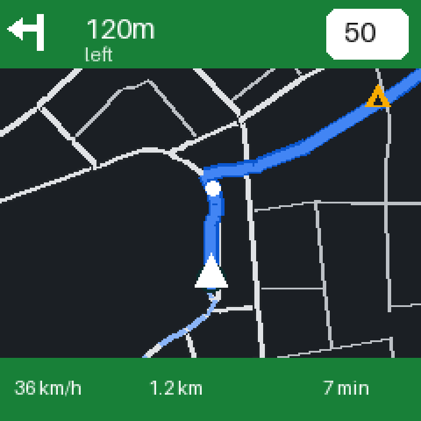
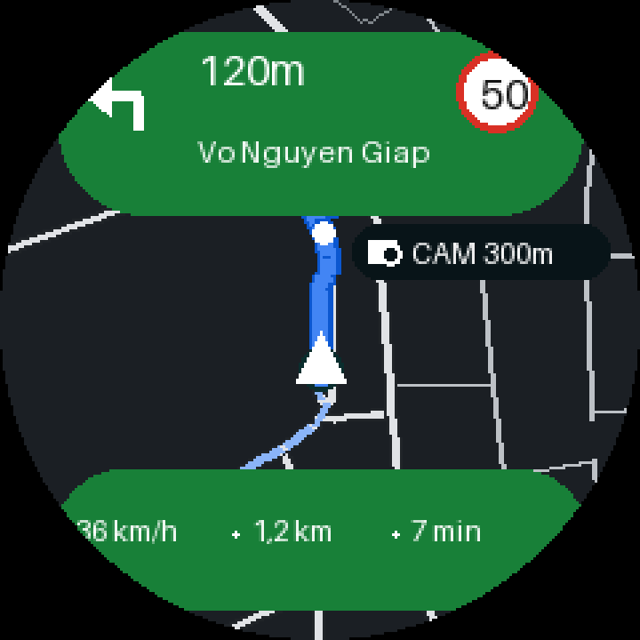

# Màn màu ESP32-S3 (ST7789 vuông hoặc GC9A01 tròn 240×240)

Firmware `esp32-s3-tft` và `esp32-s3-round` vẽ bản đồ vector OSM offline trên màn màu, nhận tuyến và vị trí từ app qua BLE. Không dùng Wi-Fi, không cần tile raster.



*Ảnh mô phỏng 240×240 dựng từ shard OSM và tuyến OSRM thật; không phải ảnh chụp phần cứng.*



*Bố cục GC9A01 tròn: banner và thanh dưới bo theo vòng tròn, cùng dữ liệu và chân SPI với bản vuông.*

## Phần cứng

- ESP32-S3 có PSRAM (8 MB), flash 8 MB trở lên.
- Màn ST7789 240×240 (GMT130-V1.0 hoặc tương đương) hoặc GC9A01 240×240 tròn, SPI.
- microSD gắn SPI riêng.

Chân mặc định (đổi bằng `build_flags` nếu mạch của bạn khác):

| Tín hiệu | GPIO |
|---|---|
| TFT SCLK | 12 |
| TFT MOSI | 11 |
| TFT DC | 9 |
| TFT CS | 10 |
| TFT RST | 8 |
| TFT BL | 7 |
| SD SCLK | 39 |
| SD MOSI | 40 |
| SD MISO | 41 |
| SD CS | 42 |

GPIO 33–37 thường bị PSRAM octal chiếm trên ESP32-S3 N8R8, nên bộ chân SD mặc định đã tránh các chân này. Với board N8R2, đổi `board_build.arduino.memory_type` từ `qio_opi` sang `qio_qspi`.

Ví dụ ghi đè:

```ini
build_flags =
  -D ROADLINK_TFT=1
  -D TFT_SCLK=14 -D TFT_MOSI=13 -D TFT_DC=15 -D TFT_CS=21 -D TFT_RST=47 -D TFT_BL=48
```

## Chuẩn bị dữ liệu bản đồ

```bash
node scripts/build-map-pack.mjs
```

Lệnh tạo `firmware/mapdata/*.rlm` từ gói OSM trong `public/data/vn-osm-20261120/tiles` (1.259 shard, ~5,7 MB). Chép thư mục này vào thẻ SD thành:

```text
/map/210_1058.rlm
/map/210_1059.rlm
...
```

Tên shard là `lat*10_lon*10`, lưới 0,1° (~11 km). Thiết bị nạp shard chứa vị trí hiện tại; rời sang shard khác thì tự nạp lại.

## Build và nạp

```bash
pio run -e esp32-s3-tft -t upload
pio run -e esp32-s3-round -t upload
```

`esp32-s3-tft` dùng `Panel_ST7789`; `esp32-s3-round` dùng `Panel_GC9A01` và bật `ROADLINK_ROUND=1`. Hai env dùng chung `tft_main.cpp`, chân SPI và pack bản đồ.

Sau khi nạp: cắm thẻ SD, bật nguồn, kết nối `RoadLink ESP32` trong app, bật lớp “Giới hạn tốc độ, biển báo & camera” rồi bắt đầu dẫn đường.

## Hiển thị

- Nền tối, đường tô theo cấp: quốc lộ vàng, tỉnh lộ vàng nhạt, phố trắng, hẻm xám.
- Tuyến xanh đậm viền xanh nhạt; đoạn đã đi mờ hơn; điểm rẽ kế tiếp là chấm trắng; biển/camera là tam giác vàng nhấp nháy.
- Xe cố định gần đáy, bản đồ xoay heading-up; vị trí ngoại suy giữa các gói `nav` (4 gói/giây).
- Banner xanh trên: mũi tên rẽ, khoảng cách, giới hạn tốc độ.
- Thanh xanh dưới: tốc độ, quãng đường còn lại, số phút.
- Vẽ mục tiêu 15 lần/giây vào sprite 240×240 trong PSRAM rồi đẩy một lần, nên không nháy; heading bản đồ được làm mượt 20%/frame và vị trí ngoại suy bị giới hạn 2 giây.
- Đường được lọc theo bbox trước khi chiếu, mỗi điểm chỉ chiếu một lần; thiếu shard/SD thì thử lại sau 2 giây và hiện `NO SD CARD`/`NO MAP DATA` thay vì mở thẻ liên tục.

## Khác biệt bản tròn GC9A01

- Banner trên và thanh dưới là hình chữ nhật bo tròn nằm trong vòng tròn hiển thị, không kéo hết mép màn để tránh bị cắt ở góc.
- Xe đặt tại `(120, 138)` thay vì `(120, 158)`; vùng bản đồ và ngưỡng vẽ tam giác cảnh báo tính theo vùng nhìn của màn tròn.
- Cảnh báo hiện nhãn `CAM/LIGHT/STOP/SIGN/...` trong banner và tam giác chỉ vẽ khi còn trong tầm nhìn (~157 m ở mức zoom hiện tại); thanh trên vẫn ghi khoảng cách tới 900 m.
- Vật lý màn tròn che 4 góc nên phần ngoài vòng tròn là đen; không cần mask phần mềm.

## Giới hạn hiện tại

- Chưa có tên đường trên màn (font mặc định không có dấu tiếng Việt); cần font VLW tiếng Việt để thêm.
- Mỗi lần chỉ nạp một shard; cửa sổ bản đồ ~570 m nên đủ, nhưng gần biên shard có thể thiếu đường bên kia.
- Chưa có nhà/công trình, chỉ đường OSM.
- Chưa kiểm thử trên phần cứng thật; pin mặc định phải khớp mạch của bạn.
